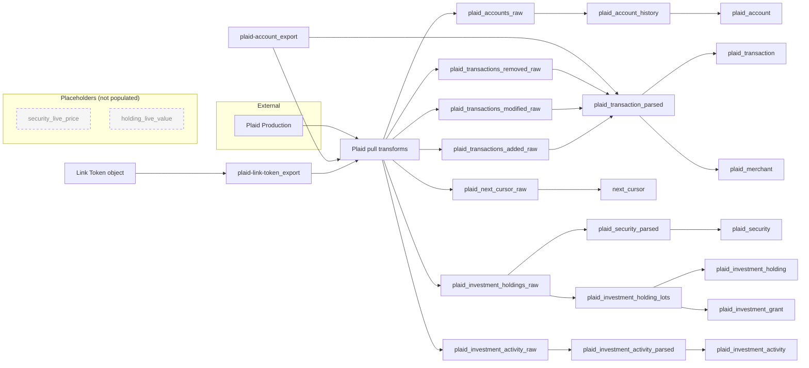

# Plaid Foundry Integration

> **Warning:** This package has been tested but is a simplification of a more complex workflow. If you have trouble installing or configuring it, post on the Palantir Community forum.

## Scope

This document covers the Plaid Foundry Integration:

* **Plaid ingestion.** Accounts, banking transactions, investment holdings and investment activity from Plaid Production.

* **The parsing and curation pipelines** that turn raw API responses into Ontology backing datasets.

* **The Ontology object types** built on those datasets, and the rules for calculating with them.

* **The Plaid App Integration workflow** (Part 5), which links, re-authenticates and disconnects institutions and writes the **Link Token** objects that the pipeline reads.

Downstream applications built on this data, such as dashboards, budgeting tools and review workflows, are out of scope.

> **Production safety boundary:** Don't use real financial data until your organization's security, privacy, legal, governance and Plaid production-access reviews are complete. Plaid client secrets, Plaid access tokens, encryption keys and source credentials must never reach a browser, a notebook output, a log or this documentation.

***

# Part 1: Environment Setup

## A. Get Plaid Production access

### Account ownership and security

1. Create a Plaid account under your personal email and information.

2. Fill out the Plaid production questionnaire. Request access to these products:

   * **Transactions**, for banking transactions through the transactions sync endpoint.

   * **Investments**, for holdings, securities and investment transactions.

3. You can also add products later from the Products page of the Plaid dashboard.

4. Expect production approval to take a couple of days.

### Production credentials

Once Plaid grants Production access, retrieve the Plaid **client ID** and **Production secret** from <https://dashboard.plaid.com/developers/keys>. The Production API host is `production.plaid.com`, and all traffic uses HTTPS on port 443.

## B. Create the egress policies

Create a separate network egress policy for each external host. Don't combine them, and don't use wildcard hosts.

| **Policy** | **Host** | **Port** | **Protocol** | **Used by** |
| --- | --- | --- | --- | --- |
| Plaid Production | `production.plaid.com` | 443 | HTTPS | Plaid Production source |

For each policy:

1. In Data Connection, create a new direct-connection egress policy for the host and port above.

2. Submit the policy for approval if your enrollment requires it, and wait for approval before you attach it.

3. Attach the policy only to the matching source.

4. Give each policy a clear name, such as `Plaid Production 443`  and a description saying which source uses it and why.

## C. Configure the Plaid Production source

1. Create a dedicated **REST API** source named **Plaid - Production**, with base host `production.plaid.com`. Don't turn a Sandbox source into a Production one by swapping its credentials.

2. Attach the Plaid Production egress policy.

3. Add these additional secrets:

| **Secret key** | **Purpose** |
| --- | --- |
| `additionalSecretClientId` | Plaid client ID. Only server-side workloads use it. |
| `additionalSecretClientSecret` | Plaid Production secret. It is specific to this environment and highly privileged. |
| `additionalSecretEncryptionKey` | Dedicated Production encryption key for Plaid access tokens. Generate and manage it through your organization's secret-management process. |

1. Under code import, allow **code repositories**, **functions** and **compute modules**. The pipeline transforms and the Plaid App Integration functions (Part 5) need all three.

2. Turn on exports to this source only where they're approved. Turn on exports without markings validation only if it's explicitly approved.

3. Keep secret values out of source names, descriptions, the code-import configuration, documentation and diagnostics.

The transforms reach this source through code imports, so the source doesn't support preview.

## D. Encryption, isolation and recovery

* The ingestion pipeline decrypts Plaid access tokens only in memory. Never write decrypted tokens to a dataset.

* Keep an internal inventory of active Plaid items (institution, owner, date created) in a tightly controlled location. If a token deletion fails or a test item needs cleanup, Plaid support can produce a list of active tokens, but that can take several days.

* Store any unencrypted recovery material only if it's explicitly approved, and under the strictest available markings.

## E. Install the packages

1. Upload the Plaid Foundry Integration package `.zip` to a Marketplace store in your chosen project folder.

2. Install it. Installation has four stages:

   1. **General setup:** choose the package name and installation location.

   2. **Input configuration:** map the **Plaid - Production&#x20;**&#x73;ource and **GENERATE PLACEHOLDERS** for *security\_live\_price* and *holding\_live\_value*. These are leftover from an integration with a live-ish service for security values that I had to exclude from this package.

3. Upload the Plaid Integration Application package `.zip` to a Marketplace store in your chosen project folder.

   1. **General setup**: choose the name and installation location

   2. **Input configuration**: NSTR here

      1. Domain: put the full subdomain here (e.g. plaid-app-\[whatever domain remains that your developer console generates for domains] You might need to setup a dummy dev console on your stack to see the exact text since mine was a string of letters and numbers followed by a more generic foundry domain.

***

# Part 2: Data Architecture

## Lineage overview

> **About the placeholders:** `security_live_price` and `holding_live_value` are kept as empty slots for a possible future live-pricing integration. They're second datasources on **Security** and **Investment Holding**, so the object types still expect them to exist. They have no upstream inputs and no transforms in this package. You create them at install time with **GENERATE PLACEHOLDERS** (Part 1, step E). Don't build anything on them.

## Folder layout

| **Folder** | **Contents** |
| --- | --- |
| `data/ontology/export` | Ontology export views (Link Token, Account) that the pull transforms read. |
| `data/transform/plaid_pulls` | Append-oriented raw Plaid API responses. |
| `data/transform/plaid_parsing` | Parsed, normalized Plaid data. |
| `data/transform/plaid_ontology` | Curated backing datasets for Plaid object types. |
| `data/ontology` | Placeholder datasets `security_live_price` and `holding_live_value`. Not populated. |

## Repositories

| **Repository role** | **Transforms** |
| --- | --- |
| Plaid pulls | `plaid_accounts.py`, `plaid_transactions.py`, `plaid_investments.py` |
| Plaid parsing | `plaid_accounts_transformed.py`, `plaid_transactions_transformed.py`, `plaid_next_cursor_latest.py`, `plaid_investments_transformed.py`, `plaid_investment_activity_transformed.py` |
| Plaid Ontology | `plaid_ontology.py`, `plaid_account.py`, `plaid_security.py`, `plaid_investment_holding.py`, `plaid_investment_grant.py`, `plaid_investment_activity.py` |

A Pipeline Builder pipeline, `token_export_history`, snapshots the Link Token export into `plaid-link-token_export_history`. That snapshot is an audit trail of connection records.

## 1. Connection state inputs

| **Dataset** | **Type** | **Role** |
| --- | --- | --- |
| `plaid-link-token_export` | View, deduplicated on primary key, latest `__patch_offset` wins, `__is_deleted` honored | One row per Plaid item: encrypted access token, sync cursor, institution, owner, `created` and `last_reauth`. **Contains credentials. Restrict access.** |
| `plaid-account_export` | View | Current Account state, including manual edits. The pulls use it to scope work, and transaction parsing uses it to resolve account context such as joint accounts and account category. |
| `plaid-link-token_export_history` | Dataset | Snapshot history of the token export. **Contains credentials. Restrict access.** |

## 2. Raw Plaid pulls

Each pull iterates over the active Link Token rows, decrypts each access token in memory, calls Plaid, and appends the result along with `object_token_primary_key`, `user_id`, institution fields and `pull_timestamp`.

| **Dataset** | **Plaid endpoint** | **Contents** |
| --- | --- | --- |
| `plaid_accounts_raw` | Accounts | Accounts plus item struct and `response_json`. |
| `plaid_transactions_added_raw` | Transactions sync | JSON array of added transactions per page (`added`), with `request_id`. |
| `plaid_transactions_modified_raw` | Transactions sync | JSON array of modified transactions per page (`modified`). |
| `plaid_transactions_removed_raw` | Transactions sync | JSON array of removed transaction IDs per page (`removed`). |
| `plaid_next_cursor_raw` | Transactions sync | `next_cursor` and `has_more` for each page. |
| `plaid_investment_holdings_raw` | Investments holdings | Full holdings and securities response (`response_json`), with holding, security and account counts. |
| `plaid_investment_activity_raw` | Investments transactions | Full investment-transactions response over a `start_date` to `end_date` window, with counts. |

Transactions sync pages through results 500 at a time until `has_more` is false.

## 3. Parsing and normalization

| **Dataset** | **Source** | **What it does** |
| --- | --- | --- |
| `plaid_account_history` | `plaid_accounts_raw` | Flattens accounts into one row per account per pull. Normalizes balances and item metadata, and adds item error fields (`item_error_type`, `item_error_code`, `item_error_message`, `has_item_error`) and a UTC consent expiration. |
| `plaid_transaction_parsed` | Added, modified and removed raw transactions, plus `plaid-account_export` | Explodes the JSON arrays into one row per transaction, applies modifications, drops removed IDs, and adds `amount_true` (expense-positive), `account_category` and `source_account_id`. |
| `next_cursor` | `plaid_next_cursor_raw` | Keeps the latest cursor per Plaid item. Backs **Next Cursor**. |
| `plaid_security_parsed` | `plaid_investment_holdings_raw` | One row per security from the latest holdings pull, with identifiers (CUSIP, ISIN, SEDOL, FIGI), close price and close date. |
| `plaid_investment_holding_lots` | `plaid_investment_holdings_raw` | One row per grant or lot (`account:security:lot_index`), with vested and unvested quantity and value, and `implied_unit_value` to detect options. |
| `plaid_investment_activity_parsed` | `plaid_investment_activity_raw` | One row per investment transaction, with security fields resolved and cancellations flagged. |

## 4. Ontology backing datasets

| **Dataset** | **Object type** | **Notes** |
| --- | --- | --- |
| `plaid_account` | Account | Latest state per account, plus lifecycle fields (open and close date, status, last seen, active in Plaid, stale), balance time series IDs and day-change fields. |
| `plaid_transaction` | Transaction | Current-state transactions. Can optionally combine Plaid data with a legacy transaction migration for history before each account's first Plaid transaction. |
| `plaid_merchant` | Merchant | Canonical merchant identities derived from transaction merchants. |
| `next_cursor` | Next Cursor | Sync checkpoint. Pipeline state only. |
| `plaid_security` | Security | Reference data for securities. |
| `plaid_investment_holding` | Investment Holding | Lots summed per account and security. |
| `plaid_investment_grant` | Holding Lot | Individual grants and lots. |
| `plaid_investment_activity` | Investment Activity | Adds `activity_category`, `is_external_cash_flow`, `month_formatted` and `sign_matches_category`. |

## 5. Placeholder datasets

| **Dataset** | **Object type** | **Status** |
| --- | --- | --- |
| `security_live_price` | Security (second datasource) | Placeholder. No inputs, no transform. Its properties are empty (see Part 3). |
| `holding_live_value` | Investment Holding (second datasource) | Placeholder. No inputs, no transform. Its properties are empty (see Part 3). |

## 6. Schedules

| **Schedule** | **Trigger** | **Failure behavior** | **Purpose** |
| --- | --- | --- | --- |
| Plaid Data | Every three hours at minute 15, America/New\_York | Abort downstream work on failure | Pull and parse accounts, transactions and investments. |
| Plaid Ontology | Its parsed inputs update | Continue independent work where possible | Build the curated backing datasets. |

***

# Part 3: Ontology Reference

| **Object type** | **Primary key** | **Purpose** |
| --- | --- | --- |
| Link Token | Connection key | One Plaid item. Holds the encrypted access token, sync cursor, `created` and `last_reauth`. **Contains credentials.** |
| Next Cursor | Token primary key | Sync checkpoint. Don't use it in financial queries. |
| Account | Plaid account ID | Balances, type and category, connection health, lifecycle and replacement lineage. |
| Transaction | Transaction ID | The authoritative current-state fact table for spending, income and cash flow. |
| Merchant | Entity ID | Canonical merchant identity, with promotion and merge lifecycle. |
| Security | Plaid security ID | Instrument reference data and the Plaid close price. |
| Investment Holding | `account_id:security_id` | Position per account and security. |
| Holding Lot | `account:security:lot_index` | Individual grant or lot. The index is positional and can reshuffle after a vest. |
| Investment Activity | Investment transaction ID | Buys, sells, dividends, vests, contributions, fees, deposits and withdrawals. |

## Properties not in use

These properties come from the placeholder datasources (Part 2, section 5). Expect them to be empty, and don't use them in calculations.

* **Security:** Effective Price, Effective Price Date, Live Price, Day Change, Day Change %, Previous Close (Finnhub), Day Open, Day High, Day Low, Live Price As Of, Live Price Pulled At, Price Source.

* **Investment Holding:** Live Value, Day Change Value, Change Since Plaid, Price Source, Effective Price Date.

## Calculation rules

**Transactions**

* Filter periods on `Date`.

* Use `Amount`: expenses are positive, and income and refunds are negative. Present income as the negated sum.

* Leave out rows where `Pending` is true, and rows in the **Transfer** parent category.

* Never mix `Amount` with `Source-Signed Amount`. The source-signed value exists only for reconciliation.

* `Review Status` and `AIP Status` are workflow state. Neither one tells you whether a transaction has settled.

**Accounts**

* Group by `Account Category`: Transactional or Investment. Keep Investment balances separate from cash totals.

* For credit and loan accounts, `Current Balance` is the amount owed.

* Leave out accounts where `Joint Account ID` is set. They are duplicate copies of a jointly held account.

* Use `Status` to filter down to accounts in use.

**Investments**

* In Investment Activity, a positive `Amount` means cash *left* the account. That is the **opposite** sign convention from Transaction.

* Leave out rows where `Is Cancelled` is true. Use `Is External Cash Flow` to separate real money movement from internal moves between cash and securities.

* In Investment Holding, `Total Value` includes unvested equity, and `Vested Value` is what you own outright. Option grants are valued at intrinsic value.

* For current valuation, use `Total Value`, or `Vested Value` for what you own outright. Both are as of `Holdings As Of`.

**Merchants**

* Use `Authority Level` to tell whether a merchant is canonical. `Merchant Status` is workflow state, and the two are always written together.

***

# Part 4: Operations

## Connection lifecycle

1. The Plaid App Integration (Part 5) runs Plaid Link, exchanges the public token on the server, and writes a **Link Token** object containing the encrypted access token.

2. The next Plaid Data run reads that token from the export, decrypts it in memory and pulls the data.

3. When the user re-authenticates in update mode, the **Edit Plaid Link Token Metadata** action sets `Last Re-auth`. Use `Last Re-auth`, or `Created` if it's null, to judge how fresh a connection is.

4. To disconnect, revoke the item with Plaid **before** you delete the Link Token record. Then check that the accounts show as inactive or stale and that no further pulls use the item.

## Cursor lifecycle

Each transactions sync starts from the stored cursor and pages through until `has_more` is false. Advance the cursor only after **every** raw output for that sync has been written successfully. If the cursor moves first and a later step fails, the next run will skip those changes permanently.

## Running a stage manually

* Don't reset or edit a cursor as your first response to a failure.

* Work out which stage failed: authentication and egress, raw pull, parsing, curation or indexing.

* Rerun the smallest failed stage whose inputs are complete and unchanged.

* Afterwards, check row counts, cursor advancement, account health and the most recent build timestamps.

## Monitoring checklist

* \[ ] The latest Plaid Data build succeeded, within three hours plus your tolerance.

* \[ ] The Plaid Ontology builds ran after their parsed inputs changed.

* \[ ] `Last Seen In Plaid`, `Is Active In Plaid`, `Stale` and item error flags have been reviewed.

* \[ ] Investment Holding `Holdings As Of` is recent.

* \[ ] Object indexes are fresh for every object type listed in Part 3.

## Troubleshooting

| **Symptom** | **Likely cause** | **First checks** |
| --- | --- | --- |
| Plaid 401, 403 or `ITEM_LOGIN_REQUIRED` | Credentials, item state or decryption | Confirm the source secrets exist, check the item error fields on Account, and re-authenticate the item if needed. Never print token values. |
| Network failure to Plaid | Egress policy or source | Confirm the host and port 443 policy is approved and attached to the right source. |
| Raw pull succeeds, parsing fails | Unexpected payload shape | Inspect the schema and error metadata only. Keep the current cursor until parsing succeeds. |
| Parsing succeeds, objects are stale | Curation or indexing | Check the Ontology builds, the backing datasets and the object indexing status. |
| Missing transaction changes | Cursor got ahead of the outputs | Stop editing the cursor, compare the last successful raw outputs against the stored cursor, and recover from a known-good state with the owner. |

## Security notes

* Link Token, `plaid-link-token_export` and `plaid-link-token_export_history` contain credential material. Restrict them with markings and roles. Hiding a property doesn't secure it.

* Make sure every downstream dataset inherits the right markings. Raw pull outputs include full Plaid responses.

* Never copy tokens, raw responses that contain credentials, client secrets or encryption keys into documentation, notebooks or logs.

***

# Part 5: Plaid App Integration Workflow

The **Plaid App Integration** workflow groups the resources that create, re-authenticate, inspect and remove Plaid connections. It is the only path that writes **Link Token** objects, and the ingestion pipeline depends on those objects.

## Components

| **Resource** | **Type** | **Role** |
| --- | --- | --- |
| Plaid Integration App | Developer Console application (OSDK) | Hosts the front end that runs Plaid Link and calls the functions and actions below. |
| `plaid_generate_link_token` (`plaidGenerateLinkToken`) | Deployed-app function | Requests a Plaid Link token for a new Production connection. |
| `plaid_generate_link_token_update_mode` (`plaidGenerateLinkTokenUpdateMode`) | Deployed-app function | Requests a Link token in update mode for an existing item, so the user can re-authenticate without creating a new access token. |
| `plaid_generate_sandbox_link_token` | Deployed-app function | Requests a Sandbox Link token. Testing only, with no Ontology binding. Don't expose it in a production-only deployment. |
| `plaid_get_item` (`plaidGetItem`) | Deployed-app function | Fetches Plaid item status (health, errors, consent) for an existing connection. |
| `plaid_remove_item` (`plaidRemoveAccessToken`) | Deployed-app function | Revokes the item with Plaid and removes the connection. |
| `add_public_and_access_token_to_plaid_object_type` | Ontology edit function (code repository) | Exchanges the public token for an access token on the server, encrypts it, and creates the Link Token object. |
| **Add Plaid Link Token** (`create-plaid-public-token-store`) | Function-backed action | Wraps the exchange function. Parameters: `publicToken`, `metadata`, `user`, `prod` (boolean, true for Production). Generates a UUID primary key. |
| **Edit Plaid Link Token Metadata** (`edit-token`) | Declarative action | Overwrites `metadata` and stamps `last_reauth` with the current time on an existing Link Token. Doesn't touch Access Token. Parameters: Plaid Link Token, `metadata`. |

> **API name note:** Keep **Edit Plaid Link Token Metadata** on the API name `edit-token`, because that's what the deployed app calls. Renaming it, or giving another action this API name, breaks re-auth write-back until the app is updated and redeployed.

## Flows

### New connection

1. The user opens the Plaid Integration App.

2. The app calls `plaidGenerateLinkToken` and launches Plaid Link with the returned token.

3. The user authenticates with their institution. Plaid Link returns a short-lived public token and session metadata in the browser.

4. The app submits **Add Plaid Link Token** with the public token, the metadata, the current user and `prod = true`.

5. On the server, `add_public_and_access_token_to_plaid_object_type` exchanges the public token, encrypts the access token with `additionalSecretEncryptionKey`, and creates the Link Token.

6. The next Plaid Data run picks up the connection (Part 4).

### Re-authentication (update mode)

1. The user selects an existing connection that needs re-auth, for example one showing `ITEM_LOGIN_REQUIRED` in the Account item error fields.

2. The app calls `plaidGenerateLinkTokenUpdateMode` for that item and launches Plaid Link.

3. When the session succeeds, the app submits **Edit Plaid Link Token Metadata**. It refreshes the linked sub-account metadata and sets `Last Re-auth`.

4. The existing access token stays in use. The next pull should clear the item errors.

### Status check

* `plaidGetItem` returns the live Plaid item status for a connection. Use it to confirm an error before you ask the user to re-authenticate.

### Disconnect

1. Confirm the target user and Plaid item.

2. Call `plaidRemoveAccessToken`. It revokes the item with Plaid before the local connection record is deleted.

3. Check that no further pulls use the item, and that the affected Accounts show as inactive or stale.

## Configuration requirements

* **Source access:** the deployed-app functions and the exchange function import the **Plaid - Production** source. Its code-import settings must allow functions and compute modules (Part 1, step C).

* **Application scope:** the Developer Console application's OSDK scope must include the Link Token object type, both actions, and the functions above.

* **Content Security Policy:** the application's hosting configuration must let Plaid Link load:

  * `scriptSrc` and `frameSrc`: the Plaid CDN.

  * `connectSrc`: the Plaid CDN and the Production host.

* Remove the Sandbox and Development origins unless the same app intentionally serves those environments. After every CSP change, test Link initialization, institution selection, the OAuth return, the public-token callback, and the browser console for CSP errors.

* **Permissions:** both actions have a validation rule that requires the submitter to hold a specific organization marking. Set it to your own organization's marking when you install. Users without it get "You do not have permission to submit this action."

* **Front-end hygiene:** never log the public token, Link metadata or any token values to the browser console.

## Troubleshooting

| **Symptom** | **Likely cause** | **First checks** |
| --- | --- | --- |
| Plaid Link won't open | CSP blocking, or Link token generation failed | Check the browser console for CSP errors and check `plaidGenerateLinkToken` executions. |
| Link succeeds but no Link Token appears | Exchange failure or permission denial | Check executions of **Add Plaid Link Token** and its exchange function, and confirm the submitter holds the required organization marking. |
| Re-auth succeeds but `Last Re-auth` doesn't change | Action API name mismatch | Confirm **Edit Plaid Link Token Metadata** still has the API name `edit-token`. |
| Item errors persist after re-auth | Pull not yet run, or the wrong item was updated | Wait for the next Plaid Data run, then call `plaidGetItem` for the item. |
| Disconnected institution still pulls | Link Token not removed | Confirm `plaidRemoveAccessToken` succeeded and that the record no longer appears in `plaid-link-token_export`. |
